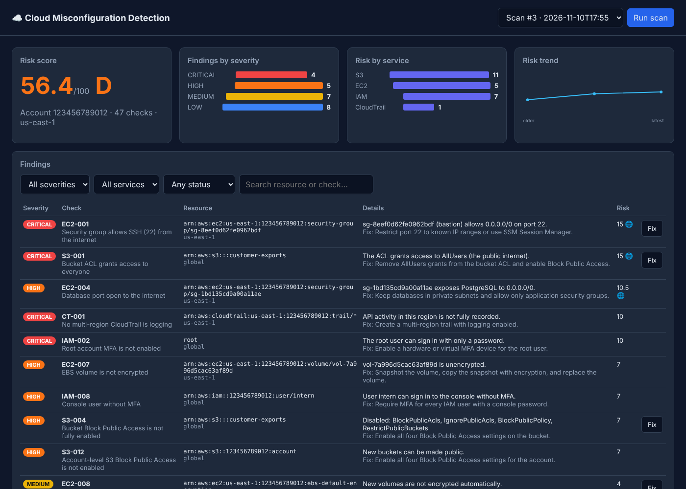

# AWS Cloud Misconfiguration Detection System

A Cloud Security Posture Management (CSPM) tool that scans an AWS account with **47 boto3 security checks** across IAM, S3, EC2/VPC, CloudTrail and KMS, scores the risk, stores findings in **PostgreSQL**, and serves them through a **Flask REST API** and a **Vue.js dashboard**. It can fix common issues automatically, ships scan logs to the **ELK Stack**, and runs daily in **GitHub Actions** using **OIDC** (no stored AWS keys).




## Features

- **47 security checks** mapped to CIS AWS Foundations themes (root account, MFA, key rotation, public buckets, open ports, encryption, logging)
- **Risk scoring**: each finding is weighted by severity (Critical 10, High 7, Medium 4, Low 1) and multiplied by 1.5 when the resource is internet-exposed; the account gets a 0 to 100 score and an A to F grade
- **Auto-remediation** for 14 checks (Block Public Access, bucket encryption and versioning, closing world-open SSH/RDP, IMDSv2, EBS default encryption, password policy). Everything defaults to dry run.
- **Flask REST API** with optional bearer-token protection for write endpoints
- **Vue.js dashboard**: risk score, severity and service breakdown, trend over time, filterable findings, one-click fixes
- **PostgreSQL** storage with SQL reporting queries (severity counts, risk by service, riskiest resources, trend)
- **Multi-region** scanning; a single failing check is isolated and reported without stopping the scan
- **Structured JSON logging** shipped by Logstash into Elasticsearch and searchable in Kibana
- **Tests**: 55 pytest tests including **pytest-bdd** Gherkin scenarios, all against a mocked AWS account (**moto**), on SQLite and PostgreSQL
- **CI/CD**: GitHub Actions runs every test on each commit; a scheduled workflow scans the real account daily via OIDC and uploads the report

## Architecture

```
            GitHub Actions (daily cron, OIDC) ──┐
                                                ▼
 Vue dashboard ──► Flask REST API ──► Scanner ──► 47 checks ──► boto3 ──► AWS (IAM, S3, EC2, CloudTrail, KMS)
                        │                │
                        │                ├──► Risk scoring
                        │                └──► Remediation (dry run by default)
                        ▼
                   PostgreSQL (scans, findings, reports)

 Scanner JSON logs ──► Logstash ──► Elasticsearch ──► Kibana
```

## Quick start

```bash
pip install -r requirements.txt
aws configure                                   # or any normal AWS credentials
python -m misconfig checks                      # list all 47 checks
python -m misconfig scan --regions us-east-1 eu-west-1 --out report.json
python -m misconfig scan --remediate            # show what would be fixed
python -m misconfig scan --remediate --apply    # actually fix it
python -m misconfig scan --fail-on HIGH         # exit code 2 if HIGH or worse (CI gate)
```

Use a read-only role for scanning (the AWS managed `SecurityAudit` policy is enough). Remediation needs only the narrow permissions listed in [`infra/github-oidc-role.yaml`](infra/github-oidc-role.yaml).

## Dashboard, API and database (Docker)

```bash
docker compose up -d                    # API + dashboard on http://localhost:5000, PostgreSQL
docker compose --profile elk up -d      # also Elasticsearch, Logstash and Kibana on http://localhost:5601
```

| Method | Endpoint | Description |
| --- | --- | --- |
| GET | `/health` | Liveness check |
| GET | `/api/checks` | All checks with severity and whether they auto-remediate |
| POST | `/api/scans` | Run a scan. Body: `{"regions": [...], "checks": [...]}` |
| GET | `/api/scans` | Scan history |
| GET | `/api/scans/<id>` | Scan summary |
| GET | `/api/scans/<id>/findings?severity=&service=&status=` | Filtered findings |
| GET | `/api/scans/<id>/report` | Severity counts, risk by service, top resources, trend |
| POST | `/api/findings/<id>/remediate` | Fix a finding. Body: `{"dry_run": false}` |

Set `API_TOKEN` to require `Authorization: Bearer <token>` on POST requests.

## Daily scans with GitHub Actions and OIDC

1. Deploy the role once (creates the GitHub OIDC provider and a `SecurityAudit` role trusted only by this repo):
   ```bash
   aws cloudformation deploy --template-file infra/github-oidc-role.yaml \
     --stack-name misconfig-scanner-oidc --capabilities CAPABILITY_NAMED_IAM \
     --parameter-overrides GitHubRepo=AnishBhardwajTech/aws-misconfig-detector
   ```
2. Copy the `RoleArn` output into the repository variable `AWS_SCAN_ROLE_ARN` (Settings → Secrets and variables → Actions → Variables).
3. [`scheduled-scan.yml`](.github/workflows/scheduled-scan.yml) then runs every day at 02:30 UTC, uploads `report.json` and the JSON log, and fails if a Critical finding exists. Run it manually with "remediate" ticked to apply fixes.

## Tests

```bash
pip install -r requirements-dev.txt
pytest                                                      # mocked AWS, SQLite
TEST_DATABASE_URL=postgresql://user:pw@localhost/db pytest  # also against PostgreSQL
```

The BDD scenarios live in [`tests/features`](tests/features), for example:

```gherkin
Scenario: Auto-remediation closes an open SSH port
  Given a security group allows port 22 from "0.0.0.0/0"
  When I run the scan
  And I auto-remediate every finding
  And I run the scan
  Then there is no finding for check "EC2-001"
```

## All checks

| ID | Severity | Check | Auto-fix |
| --- | --- | --- | --- |
| CT-001 | CRITICAL | No multi-region CloudTrail is logging |  |
| CT-002 | MEDIUM | CloudTrail log file validation is disabled |  |
| CT-003 | LOW | CloudTrail logs are not encrypted with KMS |  |
| EC2-001 | CRITICAL | Security group allows SSH (22) from the internet | ✅ |
| EC2-002 | CRITICAL | Security group allows RDP (3389) from the internet | ✅ |
| EC2-003 | CRITICAL | Security group allows all traffic from the internet |  |
| EC2-004 | HIGH | Database port open to the internet |  |
| EC2-005 | HIGH | Admin port open to the internet over IPv6 |  |
| EC2-006 | MEDIUM | Default security group allows inbound traffic |  |
| EC2-007 | HIGH | EBS volume is not encrypted |  |
| EC2-008 | MEDIUM | EBS encryption by default is disabled | ✅ |
| EC2-009 | CRITICAL | EBS snapshot is public |  |
| EC2-010 | MEDIUM | Instance has a public IP address |  |
| EC2-011 | HIGH | Instance allows IMDSv1 | ✅ |
| EC2-012 | LOW | Instance has no IAM instance profile |  |
| EC2-013 | HIGH | AMI owned by this account is public |  |
| EC2-014 | MEDIUM | VPC flow logs are not enabled |  |
| EC2-015 | LOW | Elastic IP is not associated |  |
| IAM-001 | CRITICAL | Root account has active access keys |  |
| IAM-002 | CRITICAL | Root account MFA is not enabled |  |
| IAM-003 | HIGH | No IAM password policy is set | ✅ |
| IAM-004 | MEDIUM | Password policy minimum length is below 14 | ✅ |
| IAM-005 | MEDIUM | Password policy does not require all character types | ✅ |
| IAM-006 | LOW | Password reuse prevention is below 24 | ✅ |
| IAM-007 | LOW | Passwords do not expire within 90 days | ✅ |
| IAM-008 | HIGH | Console user without MFA |  |
| IAM-009 | MEDIUM | Access key older than 90 days |  |
| IAM-010 | LOW | User has more than one active access key |  |
| IAM-011 | LOW | Policies attached directly to a user |  |
| IAM-012 | CRITICAL | Customer managed policy grants full admin (*:*) |  |
| IAM-013 | HIGH | User has AdministratorAccess attached |  |
| IAM-014 | HIGH | Inline user policy uses wildcard actions |  |
| IAM-015 | MEDIUM | Access key unused for 90+ days |  |
| IAM-016 | CRITICAL | Role trust policy allows any AWS principal |  |
| KMS-001 | MEDIUM | Customer managed KMS key rotation is disabled |  |
| S3-001 | CRITICAL | Bucket ACL grants access to everyone | ✅ |
| S3-002 | HIGH | Bucket ACL grants access to any AWS user | ✅ |
| S3-003 | HIGH | Bucket policy allows public access |  |
| S3-004 | HIGH | Bucket Block Public Access is not fully enabled | ✅ |
| S3-005 | MEDIUM | Bucket default encryption is not configured | ✅ |
| S3-006 | MEDIUM | Bucket versioning is not enabled | ✅ |
| S3-007 | LOW | Bucket MFA Delete is not enabled |  |
| S3-008 | LOW | Bucket server access logging is disabled |  |
| S3-009 | MEDIUM | Bucket policy does not enforce HTTPS |  |
| S3-010 | LOW | Bucket has no lifecycle policy |  |
| S3-011 | MEDIUM | Bucket static website hosting is enabled |  |
| S3-012 | HIGH | Account-level S3 Block Public Access is not enabled |  |

## Project layout

```
misconfig/
  checks/        iam.py, s3.py, ec2.py, cloudtrail.py, kms.py (the 47 checks)
  scanner.py     runs checks per region, isolates failures
  scoring.py     risk score and grade
  remediation.py automatic fixes (dry run by default)
  storage.py     PostgreSQL / SQLite store and report queries
  api.py         Flask REST API
  static/        Vue.js dashboard
  cli.py         command line
elk/             Logstash pipeline
infra/           CloudFormation for the GitHub OIDC role
tests/           pytest, pytest-bdd features, moto
```
